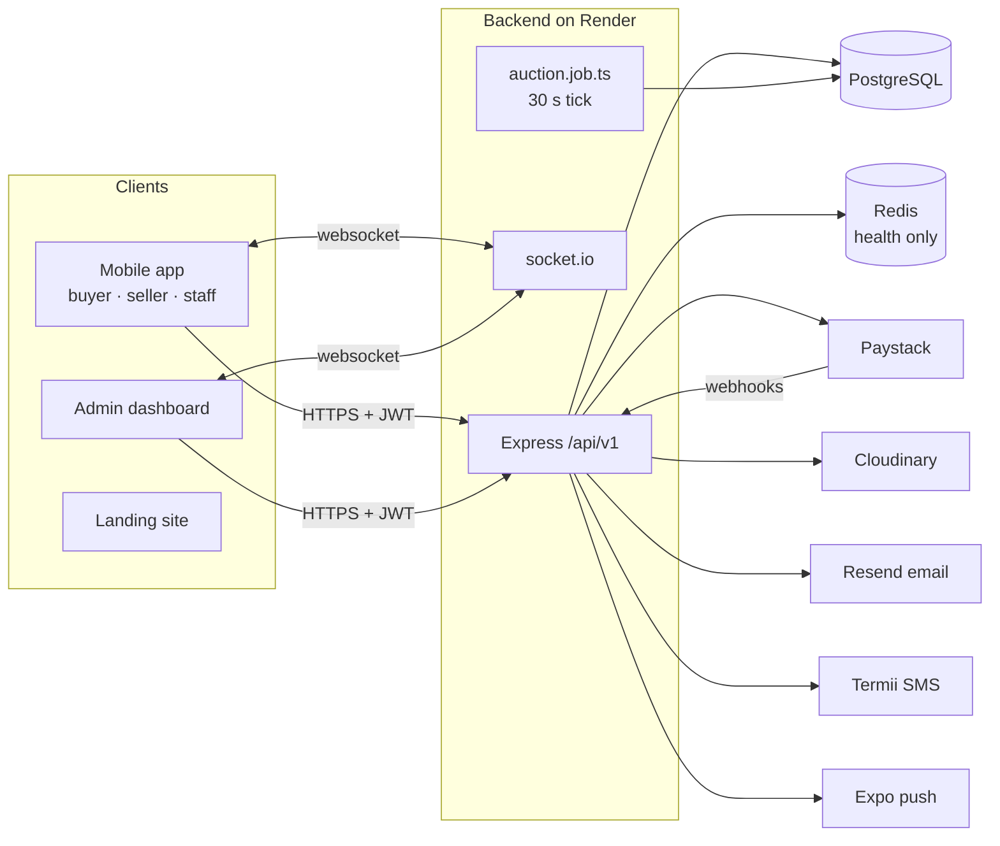

# Architecture

Map of the stack as it is in code (verified 2026-11-28). For *why*, see [DECISIONS.md](DECISIONS.md); for runtime sequences, [FLOW.md](FLOW.md); for the plain-English version, [MENTAL-MODEL.md](MENTAL-MODEL.md).

## Packages

| Package | What | Tech | Deployed to |
| --- | --- | --- | --- |
| `packages/backend` (`@gadget-bidding/backend`) | REST API + sockets + background job | Node, Express 4, TypeScript, Prisma 7 (`adapter-pg`), PostgreSQL, socket.io | Render (`render.yaml`, staging blueprint) |
| `packages/mobile` (`mobile`) | Buyer, seller and store-staff app (one binary) | Expo SDK 54, RN 0.81, React 19, zustand, React Navigation 7 | EAS (`packages/mobile/eas.json`), stores |
| `packages/admin-dashboard` | Team back office | Vite 5, React 18, Tailwind 4, shadcn | Vercel |
| `packages/web` | Public landing, privacy, terms, App Links | Astro 6 static, GSAP, three.js | Vercel (`www.gadgetsbidding.com`) |
| `packages/shared` | Types, constants, roles, device profiles, seller policy | Plain TS → CJS `dist/` | Built on `postinstall`; consumed by backend, mobile, admin (not web) |

## Backend (`packages/backend/src`)

### Layout
- `index.ts` — startup: `validateEnvironment()` → Prisma connect → `connectRedis()` (throws if down) → `initializeSocket` → `startAuctionJob()` → listen. Graceful shutdown on SIGTERM/SIGINT.
- `app.ts` — middleware and route mounting.
- `api/routes`, `api/controllers`, `api/middlewares` (auth, appGate, security/rate limits, upload, validation), `api/validators` (express-validator).
- `services/<domain>/` — business logic: address, admin, app, auction, audit, auth, bidding, buyer, gadget, media, notification, order, payment, risk, seller, socket, support, wallet.
- `config/` — `env.ts` (startup checks), `index.ts` (config object, loads `packages/backend/.env`), `prisma.ts` (client + global `omit`), `database.ts` (raw `pg` pool, still used in a few places), `redis.ts`.
- `jobs/auction.job.ts` — the only scheduler.
- `utils/` — jwt, otp, password, logger, response, errors, `wallet-balance.ts` (`applyBalanceDelta`), `bidderLabel.ts`.
- `generated/prisma` — generated client (gitignored; `build` copies it to `dist/`).
- `database/` — **legacy** `schema.sql` and SQL migrations. Not used for deploys.

### Middleware order (`app.ts`)
trust proxy (deployed) → helmet → cors → **`/api/v1/webhooks` with `express.raw`** → `express.json` (10 MB) → polling + global rate limiters → morgan (dev) → health (`/health`, `/healthz`, `/api/v1/health`) → `GET /wallet/verify` (Paystack browser callback) → static `/uploads` → routers → 404 → error handler.

### Routes (all under `/api/v1`)
| Prefix | Purpose |
| --- | --- |
| `/auth`, `/auth/seller`, `/auth/staff` | Sign-up (phone OTP, email-first, seller, staff join), login, social, 2-step, refresh, logout, password reset |
| `/me` | Buyer profile, privacy, watchlist, auto-bids, saved searches, cards, pay-with-card, ratings, missed payments, contact change, account delete |
| `/auctions` | Browse, facets, detail (counts views), create/update/cancel/relist, report |
| `/bids` | Place bid, buy-now, my bids |
| `/gadgets` | Categories, listing config, device check, price hint, image upload, create/update listing, approve/reject |
| `/orders` | Purchases/sales, address, delivery, pay (Paystack card, bank transfer, USSD, wallet), fulfilment, confirm delivery, disputes, second-chance offer |
| `/wallet` | Balance, transactions, fund, verify payment, withdraw, banks, resolve account |
| `/cases` | Dispute thread, video, return, seller reply/files/second review |
| `/addresses`, `/notifications`, `/support`, `/stores` | Address CRUD; notifications, push token, prefs; support chat; public store page + follow |
| `/seller/*` | Application, payouts, store, insights, close, tabs (home/listings/orders/notifications/drop-off codes), payout account, manage listing, listing pause, hub |
| `/staff` | Store staff app (home, mark dropped off) |
| `/admin/*` | Overview, queues, search, people & restrictions, seller applications, gadgets/listing review, listing additions, auctions, orders & inspection, disputes, payments, seller payouts, listing reports, device models, audit logs, support, data requests, app config, hub |
| `/files/private` | Signed links for private seller documents |
| `/app-config` | Public min/latest app version and maintenance state |
| `/webhooks/paystack`, `/webhooks/monnify` | Payment webhooks (raw body, signature checked) |

Route files live in `api/routes/*.routes.ts`; mount order in `app.ts` matters (e.g. `/admin/listing-reports` before `/admin`).

### Auth
- Roles: `bidder` (buyer) · `seller` · `admin` · `staff` (`shared/src/roles.ts`).
- JWT access (`JWT_SECRET`) + refresh (`JWT_REFRESH_SECRET`, stored in `refresh_tokens`, not rotated on refresh). `utils/jwt.ts`, `services/auth/auth.service.ts`.
- `authenticate` loads the user on every request (blocks inactive; `ACCOUNT_PAUSED` for paused admins; staff limited to `STAFF_PATHS`). Guards: `authorize`, `sellerOnly`, `requireSellerKyb` (→ `whyCantList`), `adminOnly`, `optionalAuth`.
- 2-step: email / TOTP / SMS (`twoFactor.service.ts`, `totp.ts`), trusted devices (max 10).
- Social: Google (tokeninfo vs `GOOGLE_CLIENT_IDS`), Apple (JWKS vs `APPLE_CLIENT_IDS`).
- Admin: same login; every non-GET admin call is audited and rate-limited. Create admins with `pnpm create-admin`.

### Realtime (`services/socket/socket.service.ts`)
One namespace, JWT handshake, rooms `auction:{id}` and `support:{threadId}`, per-user delivery via an in-memory map. No Redis adapter → single instance only.
- Client → server: `auction:join|leave`, `bid:place`, `support:join|leave`.
- Server → client: `auction:state`, `bid:placed`, `bid:outbid`, `bid:confirmed`, `bid:error`, `auction:ended`, `auction:won`, `auction:ending_soon`, `auction:extended` (maintenance give-back only), `notification`, `support:message`, `error`. (The admin dashboard also listens for `order:updated`, which the backend never emits.)

### Background work (`jobs/auction.job.ts`)
One `setInterval`, every 30 s (no Bull, no cron). Each tick, in order:
1. end expired auctions → orders + notifications
2. activate scheduled auctions
3. expire unpaid orders (missed payment → second-chance offer)
4. ending-soon alerts (1 h, 15 m)
5. unpaid-order reminders (12 h, 2 h)
6. expire second-chance offers
7. auto-confirm deliveries (48 h)
8. saved-search matches
9. store-follower alerts
10. confirm-delivery reminders
11. seller payout run (6 pm Lagos)
12. lift expired account restrictions

Steps 1, 2 and 4 pause during maintenance.

### Data (`prisma/schema.prisma`)
Money is `Decimal(15,2)` naira; timestamps are `TIMESTAMP(6)` without time zone (UTC wall-clock). Prisma migrations in `prisma/migrations` are canonical (`pnpm db:migrate`, Render `preDeployCommand`).

| Domain | Models |
| --- | --- |
| Users & auth | User, SocialAccount, RefreshToken, UserVerification, TrustedDevice, UserAddress, PushToken |
| Listings & auctions | GadgetCategory, Gadget, DeviceModel, Auction, Bid, AutoBid, Watch, SavedSearch, AuctionViewDay, ListingReport |
| Wallet | Wallet, WalletTransaction (ledger), BidHold, PaymentTransaction, SavedCard |
| Orders & payouts | Order, OrderEvent (trigger-written), MissedPayment, SellerPayout, SellerCharge, Rating |
| Cases | Dispute, DisputeMessage, DisputeReturn |
| Sellers | SellerApplication, StoreStaff, Follow |
| Admin | AuditLog, UserRiskFlag, AccountRestriction, UserNote |
| App | AppSetting (singleton), MaintenanceWindow |
| Support & privacy | SupportThread, SupportMessage, Notification, DataRequest, HelpFeedback |

### External services
| Service | Where |
| --- | --- |
| Paystack (cards, bank transfer, USSD, transfers, refunds, bank resolve) | `services/payment/paystack.service.ts`, `api/controllers/webhook.controller.ts` |
| Monnify (wallet funding; secondary) | `services/payment/monnify.service.ts` |
| Cloudinary (images, private docs) | `services/media/cloudinary.service.ts`, `services/seller/privateFiles.service.ts` (local disk fallback) |
| Resend (email) | `services/notification/email.service.ts` |
| Termii (SMS) | `services/notification/sms.service.ts` |
| Expo push (no FCM direct) | `services/notification/push.service.ts` |
| Device lookup (off by default) | `services/gadget/deviceLookup.service.ts` |

## Mobile (`packages/mobile`)

- **Config:** real `app.json` / `eas.json` are in `packages/mobile/` (scheme `gadgetbid`, bundle/package `com.gadgetbid.app`, new architecture on). Profiles: `development` (dev client), `preview` (internal APK), `production` (sets `EXPO_PUBLIC_API_URL`/`SOCKET_URL`). `expo-updates` is configured but not called. Native folders are generated; plugin `plugins/withIosSceneLifecycle.js`.
- **Entry:** `index.ts` → `initSentry()` → `App.tsx` (fonts, `AppGates`, `OfflineOverlay`, `Sentry.wrap`).
- **Navigation (`src/navigation`):** `RootNavigator` runs `checkAuth()` then picks: `AuthNavigator` (signed out) · `StaffNavigator` (role staff, one screen) · `SellerNavigator` (tabs Home/Listings/Orders/Payouts/Store) · `BuyerNavigator` (tabs Home/Explore/Watchlist/Bids/Profile, ~60 stack screens). Buyer vs seller mode is chosen at sign-in (`interfaceType`, stored in SecureStore); switching = sign out and back in. Deep links: `gadgetbid://wallet/verify`, `gadgetbid://auction/:id`; push taps route via `navigationRef`.
- **State (`src/store`, zustand):** `authStore`, `auctionStore` (+ socket room join), `walletStore`, `watchStore`, `sellerDashboardStore`, `appGateStore` (update/maintenance gates), `networkStore` (offline), `toastStore`, `errorLogStore`.
- **API (`src/services/api.ts`, axios, 30 s):** adds `X-App-Version` + Bearer; on 401 refreshes once with a queue, else signs out; maps body codes `MAINTENANCE` / `APP_UPDATE_REQUIRED` to full-screen gates; tracks online/offline. Base URL from `src/constants/config.ts` (`EXPO_PUBLIC_API_HOST` in dev, `EXPO_PUBLIC_API_URL` in prod).
- **Socket (`src/services/socket.service.ts`):** websocket only, token auth, reconnects with a fresh token.
- **Screens:** `screens/auth`, `screens/buyer/*` (grouped files: AuctionFlow, Checkout, Pay, Orders, Case, Help, Legal, Account, Address, Gate, State), `screens/sell/*` (tabs, listing wizard, onboarding, store, money, case, paused, staff, hub, manage), plus older single-purpose folders.
- **UI kit:** `components/glass` (blur surfaces, `GlassScreen`, `GlassKeyboardView`, `GlassTabBar`), `components/motion` (tokens, BottomSheet), `components/states`. Tokens in `src/constants/theme.ts`; Satoshi fonts in `assets/fonts`.

## Admin dashboard (`packages/admin-dashboard`)

- `src/App.tsx` — lazy routes; `/login`, `/forgot-password` public; everything else in `Guard` (`RequireAdmin` + `AdminShell`). Sidebar map: `src/lib/nav.ts`.
- Areas: Main (overview, notifications, tasks) · People (buyers, sellers, suspended, admins) · Queues (seller KYB `/sellers/applications`, listing review `/gadgets`, hub `/backoffice`, disputes, support) · Commerce (auctions, orders, payments, payouts) · Config (reports, rules, settings, device models, audit).
- `src/api.ts` — fetch client, `ApiError(status, code, data)`, net-state tracking, session in localStorage (`gb_admin_*`), single-flight refresh, `ACCOUNT_PAUSED` → `/login?paused=1`.
- `src/lib/socket.ts` — one socket for live counts, bids, notifications, orders, support.
- Dev: Vite proxies `/api`, `/uploads`, `/socket.io` to `:3000`. Prod: Vercel with SPA rewrite (`vercel.json`).

## Web (`packages/web`)
Astro static: `src/pages/index.astro`, `privacy/`, `terms/`, `404`. Sections in `src/components/*.astro`, static demo data in `src/data/` (no API calls). `public/.well-known/assetlinks.json` for Android App Links. Design source = the user's pasted landing design, not the app design guide.

## Shared (`packages/shared/src`)
`types/` (API, socket payloads, constants like `BID_COMMITMENT_AMOUNT`, `BID_PAYMENT_DEADLINE_HOURS`), `roles.ts`, `deviceProfiles.ts` (listing flow contract), `gadgetSpecs.ts`, `mediaUrl.ts`, `sellerPolicy.ts` (fee tiers, `SELLER_POLICY`). Backend and mobile import the built `dist/`; admin maps to `src/` directly.

## Structural limits to know
Single backend instance assumed (in-memory socket map, locks, rate limits, job interval). No automated tests. See [BUGS.md](BUGS.md) › Open.
