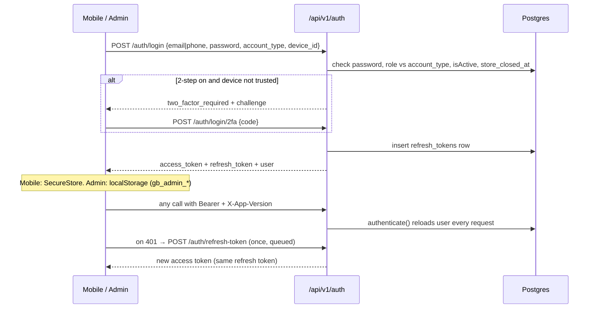
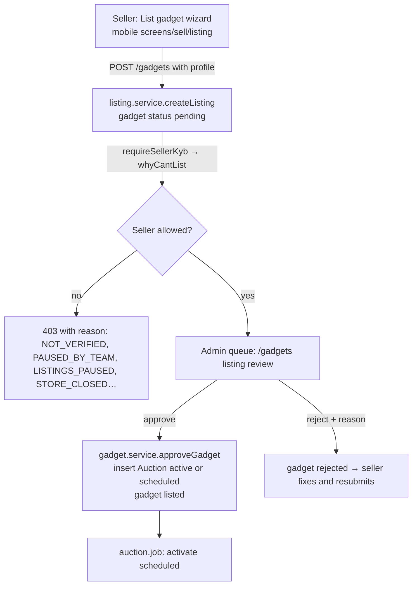
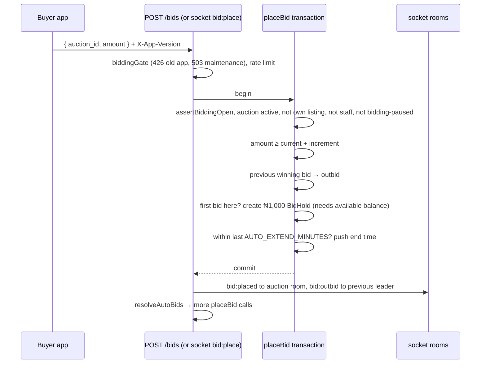
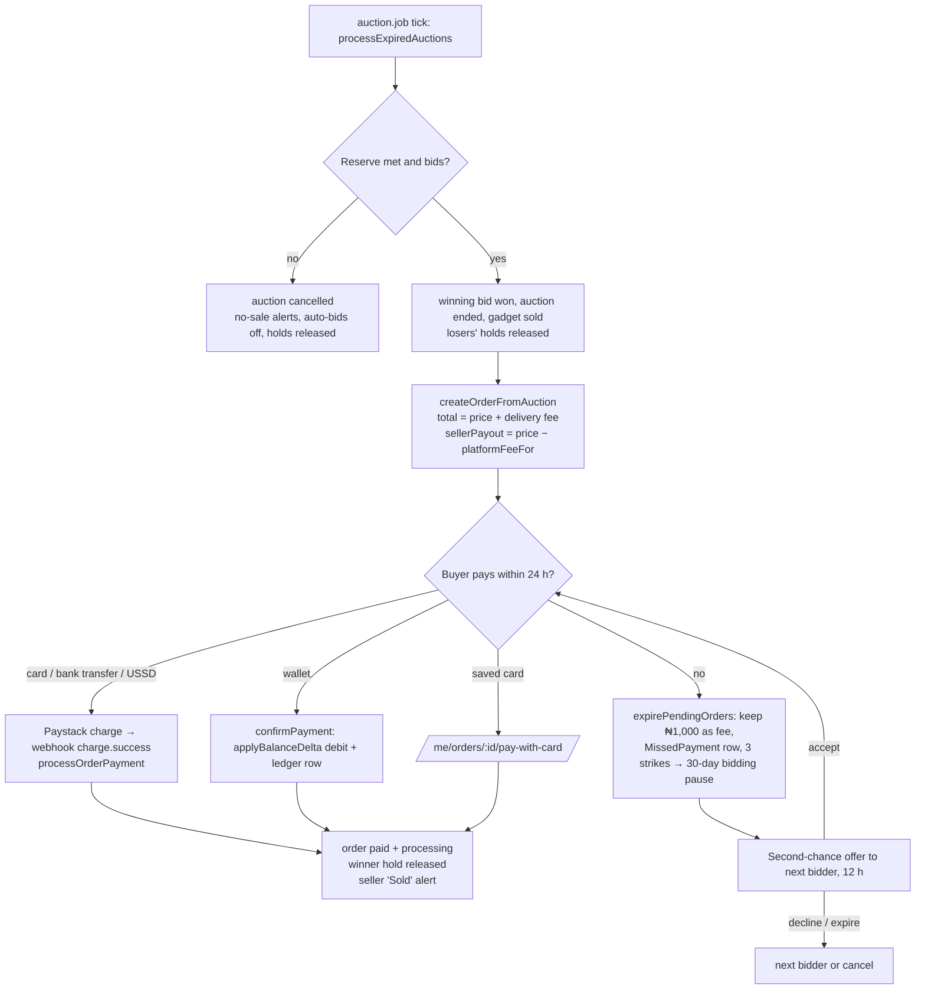
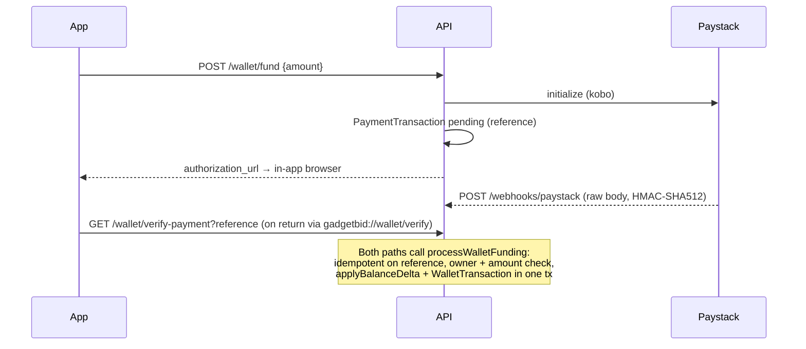
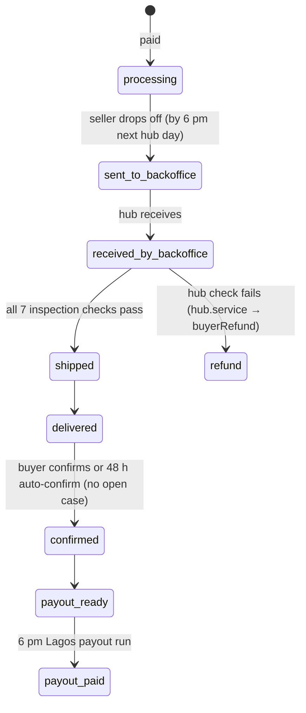
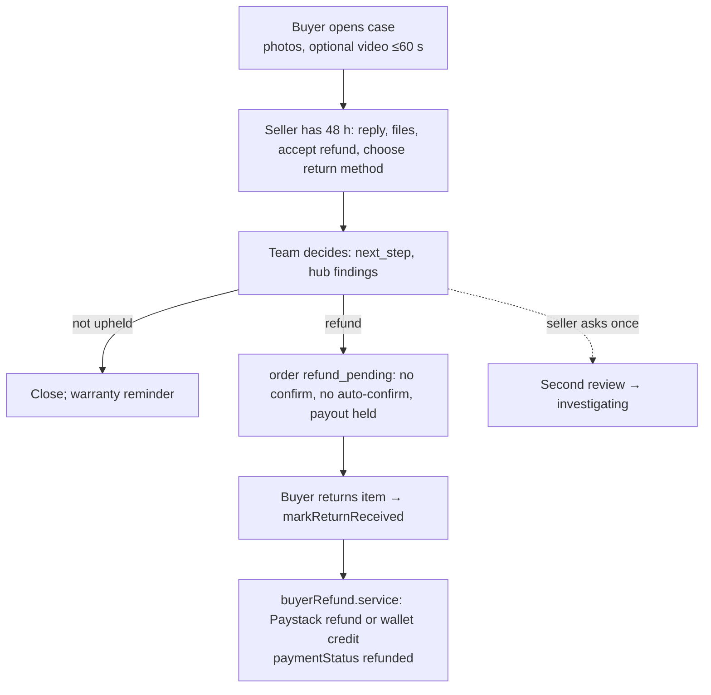
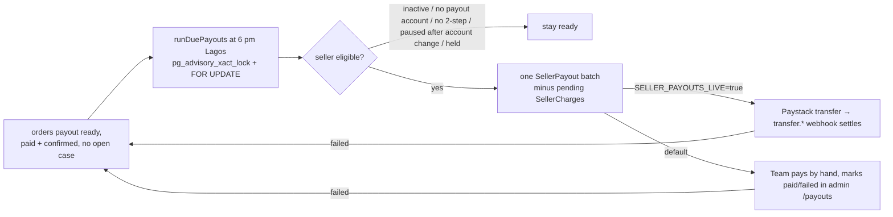

# Flows

How data moves across the apps, API, database and providers. File paths are under `packages/backend/src` unless stated. Diagrams are Mermaid (render on GitHub / VS Code).

## 1. Sign-in and session

- Sign-up variants: phone + OTP (legacy), email-first buyer (`/auth/signup/email → verify → complete`), seller (`/auth/seller/signup/*`), staff join (`/auth/staff/*`), social (`POST /auth/social`, Google/Apple).
- Mobile picks buyer vs seller at sign-in (`account_type`); the server refuses the wrong one.
- Revocation: logout = one token; password reset, account delete, store close, staff removal, admin suspend = all refresh tokens. Access JWTs live until expiry, but `isActive` is checked per request.
- Files: `services/auth/*`, `api/middlewares/auth.middleware.ts`, mobile `src/store/authStore.ts`, `src/services/api.ts`.

## 2. Listing → auction

- Device identifier (IMEI/serial) is saved privately with a hash for duplicate checks; only admin review sees it.
- Seller can manage a live listing (`/seller/manage`): edit or end while no bids; photos/notes added later go through `/admin/listing-additions`.
- Unsold → `POST /auctions/:id/relist` (one open run per gadget).

## 3. Bidding

- Available balance = wallet balance − held holds. Holds never change the balance.
- Buy-now: `biddingService.buyNow` ends the auction in one transaction; the order is created right after in `bid.controller.ts`.
- Files: `services/bidding/bidding.service.ts`, `services/buyer/autobid.service.ts`, `api/middlewares/appGate.middleware.ts`.

## 4. Auction end → order → payment

## 5. Wallet funding

Webhook `charge.success` routing order: card verification (₦50 add-card check, refunded) → order payment → wallet funding. Files: `api/controllers/webhook.controller.ts`, `services/wallet/wallet.service.ts`, `services/order/order.service.ts`, `services/buyer/savedCard.service.ts`.

## 6. Fulfilment and escrow

- Stage timestamps come from `order_events` (DB trigger `orders_record_event`).
- Staff app (`/staff`) marks drop-offs for a store.
- Buyers see inspection as `{passed,total,at}` only.

## 7. Cases (disputes) and refunds

Files: `services/buyer/case.service.ts` (buyer and seller sides), `services/order/buyerRefund.service.ts`, admin `/admin/disputes/*`.

## 8. Seller payouts

Files: `services/seller/payouts.service.ts`, `services/seller/payoutSchedule.ts`, `api/routes/adminPayouts.routes.ts`.

## 9. Notifications

`createNotification` (`services/notification/notification.service.ts`) → always: DB row + socket `notification` → then by switch (`SWITCH_FOR_TYPE` or `SELLER_SWITCH_FOR_TYPE` by role) and channel: Expo push, Resend email, Termii SMS. Quiet hours (22:00–07:00 Lagos) skip push and SMS except payment/won/defaulted alerts. Mobile routes push taps by `data.route`.

## 10. App gates and maintenance

Admin › Settings sets min/latest version and maintenance windows (`services/app/appConfig.service.ts`). Mobile reads `GET /app-config` on launch and foreground; bid endpoints return 426/503 with a body `code` the mobile interceptor turns into full-screen gates. Ending maintenance gives lost time back to affected auctions and emits `auction:extended`.
